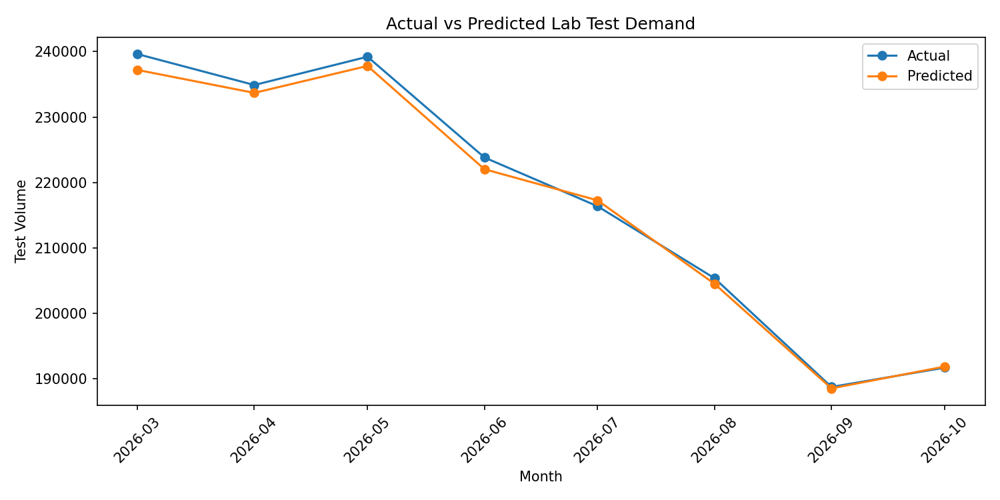
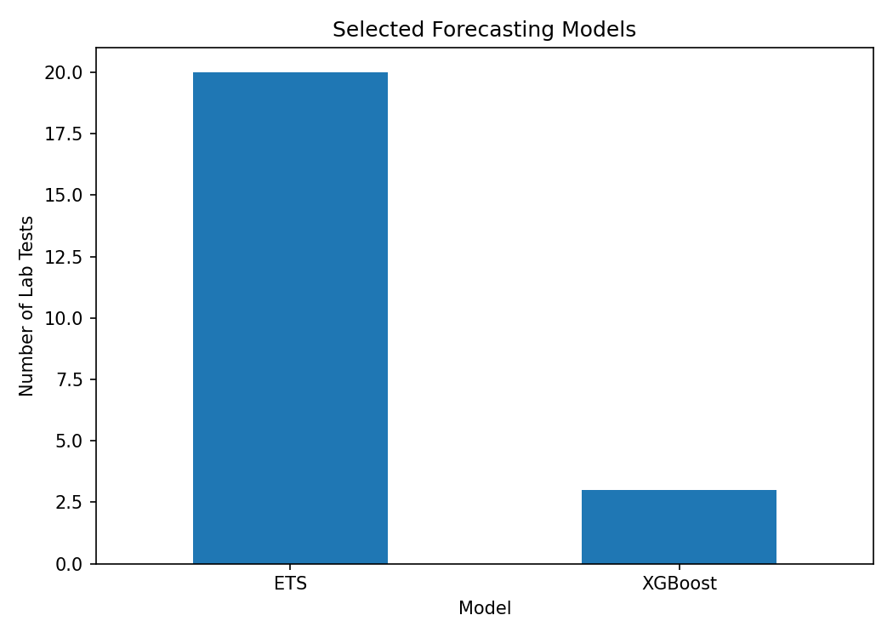

# Healthcare Lab Test Demand Forecasting

A machine learning and time-series forecasting project for predicting monthly laboratory test demand using **ETS (Exponential Smoothing)** and **XGBoost**.

> **Data note:** This public repository uses synthetic/sample data for portfolio demonstration. No private, patient-level, or company healthcare data is included.

## Objective

Forecast monthly demand for multiple laboratory tests and compare forecasting approaches using walk-forward validation.

## Approach

The project follows these steps:

1. Load and preprocess laboratory test data.
2. Aggregate daily test quantities into monthly totals.
3. Create time-series features such as:
   - Lag 1, 2, 3, 6 and 12 months
   - Rolling 3, 6 and 12 month averages
   - Month
   - Trend
4. Evaluate **ETS** and **XGBoost** using a 6-month validation window.
5. Select the better-performing model for each laboratory test.
6. Generate monthly forecasts.
7. Compare actual and predicted demand using:
   - MAE
   - RMSE
   - Error %
8. Save prediction results and visualizations.

## Models

### ETS — Exponential Smoothing

ETS captures trend and seasonal patterns in historical laboratory demand.

Configuration includes:

- Additive trend
- Damped trend
- Additive seasonality
- 12-month seasonal period

### XGBoost

XGBoost is used as a supervised machine-learning forecasting model with historical lag and rolling features.

Features include:

- Lag values
- Rolling averages
- Month
- Time trend

## Model Selection

For each laboratory test, ETS and XGBoost are evaluated using walk-forward validation.

The model with the lower validation **MAE** is selected for forecasting.

## Evaluation Metrics

| Metric | Purpose |
|---|---|
| MAE | Measures the average absolute forecasting error |
| RMSE | Measures error while giving more weight to larger errors |
| Error % | Measures the percentage difference between actual and predicted demand |

## Project Structure

```text
healthcare-lab-test-forecasting/
│
├── charts/
│   ├── actual_vs_predicted.png
│   └── model_comparison.png
│
├── data/
│   └── sample_lab_data.csv
│
├── results/
│   ├── model_summary.csv
│   ├── monthly_total.csv
│   └── sample_forecast_results.csv
│
├── lab_forecasting.ipynb
├── README.md
├── requirements.txt
└── .gitignore
```

## Results

The project produces:

- Lab-test-level forecasts
- Actual vs predicted comparisons
- Model selection results
- Monthly total forecasts
- MAE and RMSE evaluation
- Forecasting visualizations

### Actual vs Predicted



### Selected Forecasting Models



## Technologies Used

- Python
- Pandas
- NumPy
- Matplotlib
- Scikit-learn
- Statsmodels
- XGBoost
- Jupyter Notebook

## How to Run

Clone the repository:

```bash
git clone https://github.com/inrealkaran/healthcare-lab-test-forecasting.git
cd healthcare-lab-test-forecasting
```

Install dependencies:

```bash
pip install -r requirements.txt
```

Open the notebook:

```bash
jupyter notebook lab_forecasting.ipynb
```

The notebook uses:

```text
data/sample_lab_data.csv
```

as the demonstration dataset.

## Disclaimer

This repository is a portfolio demonstration of healthcare demand forecasting techniques. The sample dataset is synthetic and does not represent actual patient or hospital data.
